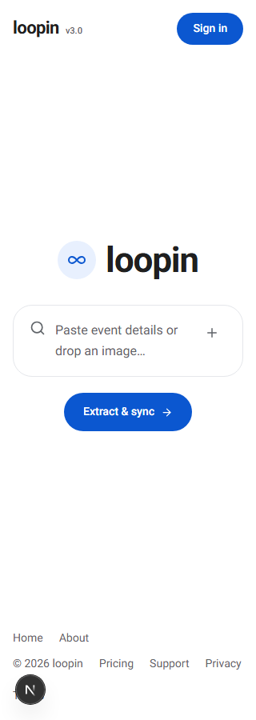
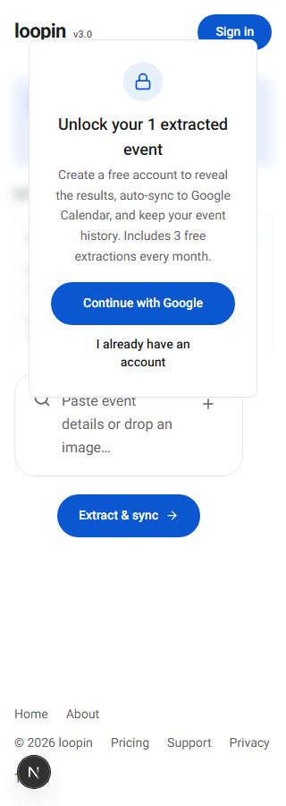

# Responsiveness Check: http://localhost:3000

**Date**: 2026-10-07
**Mode**: Standard (8-width sweep) + interactive states (extraction results, info modal, auth modal) + portrait probes
**Breakpoints tested**: 320, 375, 768, 1024, 1280, 1440, 1920, 2560 (viewport height 900) + portrait 320x568, 375x667, 390x844
**Pages tested**: `/` (landing, form, extraction results + signup gate), `/about`, `/pricing`, info modal, auth modal (`/developers` redirects to `/`)
**Browser tool**: Python Playwright + Chromium 149 (no playwright-cli/MCP available in this environment)
**Evidence**: screenshots + metrics in [`responsiveness-check-2026-10-07/`](responsiveness-check-2026-10-07/)

## Summary

| Width  | Status | Issues                      |
| ------ | ------ | --------------------------- |
| 320px  | Fail   | 1 high, 4 medium            |
| 375px  | Fail   | 1 high, 4 medium            |
| 768px  | Warn   | 1 medium                    |
| 1024px | Warn   | 1 medium                    |
| 1280px | Pass   | — (low-severity items only) |
| 1440px | Warn   | 1 medium                    |
| 1920px | Warn   | 1 medium                    |
| 2560px | Warn   | 1 medium                    |

**Overall**: 0 critical, 1 high, 5 medium, 4 low across 8 breakpoints (+3 portrait probes). No horizontal overflow anywhere (`overflowPx=0` on every page/state/width); the main failure is that the header nav vanishes below 640px with no hamburger, leaving "How it works" unreachable on phones.

**What passed everywhere**: no horizontal scroll, no clipped/overflowing text, primary CTA "Extract & sync" above the fold at every width, grid transitions clean, both modals reflow correctly (info modal tested live at 1440→375 resize).

> **Update (same day)**: the High issue and all Quick Fixes 1–6 below were implemented and re-verified — see [Fixes Applied & Re-verification](#fixes-applied--re-verification). The statuses in this report reflect the **pre-fix** state.

## Critical & High Issues

### Header navigation disappears below 640px with no hamburger — High

**Width(s)**: 320, 375 (any viewport < 640px)
**Check**: Nav transition

All three header links (`How it works`, `About`, `Pricing`) live in one `hidden sm:flex` container (`app/page.tsx`), so they vanish at exactly **640px** (verified: visible at 640, hidden at 639). No hamburger exists at any width (`hasHamburger=false` everywhere). The footer offers `About`/`Pricing` but **not `How it works`**, so that page/section is unreachable on a phone — the primary "how does this work" explainer for new users.

**Fix suggestion**: add a hamburger/menu button visible `sm:hidden` that opens a simple dropdown with the three links (plus Sign in), or at minimum surface `How it works` in the footer below 640px.

---

## Medium Issues

### Signup-gate state is cramped and overlaps the input at ≤375px — Medium

**Width(s)**: 320, 375
**Check**: Stacking / whitespace

After a real extraction, the "Unlock your 1 extracted event" gate card sits over the blurred results **and covers the top of the input box** (search icon half-hidden, placeholder wraps to 3 lines: "Paste event / details or drop an / image..."). "I already have an account" wraps to 2 lines, and blurred result rows peek out around the card. The footer grows to 3 rows / 132px tall in this state.

**Fix suggestion**: below `sm`, make the gate card flow _above_ the input in normal document flow (not overlapping), or hide the blurred preview and render the card as a full-width block with margin.

### Touch targets below 44px at <640px — Medium

**Width(s)**: 320, 375, 320x568, 375x667, 390x844 (all pages/states)
**Check**: Touch targets

- Landing / results: **8 targets** — footer links 20px tall (Home/About/Pricing/Support/Privacy/Terms), `Sign in` 83x40, logo 87x24
- `/about`: **5 targets** — `Back to app` 106x40, logo, 3 footer links
- `/pricing`: **8 targets** — currency toggle 92x**32**, `Back to app` 106x40, logo, 4 footer links
- Info modal @375: **12 targets**; Auth modal @375: **10 targets**

At ≥768px everything measures ≥44px (0 offenders).

**Fix suggestion**: add `py-2 -my-2` (or `min-h-11`) to footer links, bump `Sign in` to `h-11` and the currency toggle to `py-2.5` on mobile; wrap logo link in padding.

### Footer wraps to 3 crowded rows at ≤375px — Medium

**Width(s)**: 320, 375
**Check**: Whitespace

Footer is a clean single 60px row at ≥768px, but 132px / 3 rows at 320–375 (`Home About` / `© 2026 loopin Pricing` / `Support Privacy Terms`) with only 8px gaps — at 320 the rows nearly touch, and links are the 20px-tall targets noted above.

**Fix suggestion**: stack footer deliberately on mobile (`flex-col items-start gap-2`), or drop `Home`/`Support` into a single "More" row.

### Gate blur preview reads as broken at 768–1440px — Medium

**Width(s)**: 768, 1024, 1440
**Check**: Stacking / whitespace

The blurred result list is left-aligned inside the 1024px hero container while the gate card is centered (~445px), so blurred rows bleed out the **left** of the card and the blue result banner sticks out the **right** — asymmetric and unintentional-looking, worst at 1440 (see [results-1440-fold](responsiveness-check-2026-10-07/results-1440-fold.png), [results-768-fold](responsiveness-check-2026-10-07/results-768-fold.png)). Possibly an intentional teaser, but it currently looks unfinished.

**Fix suggestion**: center the blurred preview column behind the card, clip it to card width + padding, or replace with a neutral "results locked" backdrop.

### Ultra-wide layouts feel sparse — Medium

**Width(s)**: 1920, 2560
**Check**: Whitespace

Content is contained (header/footer 976px, hero/form `max-width: 1024px`, all centered) so nothing overflows — but at 2560 that leaves ~790px of empty margin each side and a lone centered column. The gap is visible as early as 1920.

**Fix suggestion**: scale the hero container up at `2xl` (e.g. `max-w-4xl`/`max-w-5xl` above 1536px), or give the page a subtle full-bleed background/framing so the margins read as intentional.

---

## Low Issues

- **11px micro-text (all widths)**: "v3.0" badge next to the logo; pricing "Most popular" badge; results "95% match" badge is 10px at 320. Bump to ≥12px for readability ([metrics.json](responsiveness-check-2026-10-07/metrics.json)).
- **Header/hero alignment (corrected)**: the originally reported "24px container misalignment at ≥1024" was a measurement artifact — re-measurement shows header content and form content both starting at left=232 at 1440 (the 208 figure was the hero section's outer wrapper edge, which includes padding). No visual misalignment; no fix needed.
- **`/developers` redirects to `/`**: probing it screenshots the landing page. Either implement the route or remove the link (informational, not a layout bug).
- **Dev-only**: the Next.js dev-indicator bubble overlaps the footer's bottom-left corner in dev screenshots — not a production issue.

## Transition Analysis

| Transition                        | Observed At              | Clean? | Notes                                                               |
| --------------------------------- | ------------------------ | ------ | ------------------------------------------------------------------- |
| Header nav: full → hidden         | exactly 640px            | **No** | No hamburger replacement; "How it works" becomes unreachable (High) |
| Footer: 1 row → 3 rows            | < 640px                  | Yes    | Height 60px → 132px; crowded at 320 (Medium)                        |
| Results grid: 1 → 2 cols          | 640px (`sm:grid-cols-2`) | Yes    | 1 col at 320–768, 2 cols at 768+                                    |
| About cards: 1 → 3 cols           | 640px (`sm:grid-cols-3`) | Yes    | No overlap or jump                                                  |
| Pricing cards: 1 → 3 cols         | ~768px                   | Yes    | Single stack below                                                  |
| Gate card vs input overlap        | ≤375px                   | **No** | Card covers input top; placeholder wraps 3 lines                    |
| Info modal reflow (live 1440→375) | dynamic                  | Yes    | Fits viewport, no scroll traps, tabs/steps intact                   |
| Auth modal                        | 375 / 1440               | Yes    | Centered, correct padding at both widths                            |

## Per-Breakpoint Notes

### 320px — Fail

- **[High]** Header nav fully hidden, no hamburger — "How it works" unreachable
- **[Medium]** Gate card overlaps input top; placeholder + CTA text wrap; footer 3 rows/132px
- **[Medium]** 8 touch targets <44px (footer links 20px, Sign in 40px, logo 24px)
- No horizontal overflow; CTA above fold ([320-fold](responsiveness-check-2026-10-07/320-fold.png))

### 375px — Fail

- Same four mediums as 320 (gate crowding slightly less severe; placeholder still wraps 2 lines)

### 768px — Warn

- **[Medium]** Blurred preview bleeds asymmetrically around the centered gate card
- Nav restored; 0 touch-target offenders; footer single row

### 1024px — Warn

- **[Medium]** Gate blur preview asymmetry (left-heavy)
- **[Low]** Header/hero alignment: no real offset (corrected — see Low list)

### 1280px — Pass

- Landing/about/pricing clean; only the all-width low-severity items (12px badges after fix, /developers redirect, dev-only bubble)

### 1440px — Warn

- **[Medium]** Gate blur preview asymmetry most visible (blue banner sticks out right of card)

### 1920px / 2560px — Warn

- **[Medium]** Content contained but margins huge (~472px each side at 1920, ~790px at 2560) — sparse, column feels orphaned
- Everything centered, no overflow ([2560-fold](responsiveness-check-2026-10-07/2560-fold.png))

### Portrait probes (320x568, 375x667, 390x844) — Fail

- Inherit the 320/375 findings (nav missing, touch targets, gate crowding); no overflow at any probe

## Fixes Applied & Re-verification

All fixes implemented the same day (2026-10-07) and re-verified with a fresh Playwright run; before/after screenshots live in [`responsiveness-check-2026-10-07/fixed/`](responsiveness-check-2026-10-07/fixed/).

### What changed

| #   | Issue                                                                                       | Fix                                                                                                                                                                                                                                                                                                                                                                                                                           | File(s)                                                                                                                        |
| --- | ------------------------------------------------------------------------------------------- | ----------------------------------------------------------------------------------------------------------------------------------------------------------------------------------------------------------------------------------------------------------------------------------------------------------------------------------------------------------------------------------------------------------------------------- | ------------------------------------------------------------------------------------------------------------------------------ |
| 1   | **High**: no nav below 640px                                                                | `h-11 w-11` hamburger (`sm:hidden`, `aria-label` Open/Close menu, `aria-expanded`, `aria-controls`) + `#mobile-menu` dropdown with How it works / About / Pricing / Profile / Sign in (`min-h-11 w-full` each); Escape closes                                                                                                                                                                                                 | `app/page.tsx`                                                                                                                 |
| 2   | Touch targets <44px at <640px                                                               | Nav links `h-10`→`h-11`; `Sign in` → `h-11`; profile avatar `h-10 w-10`→`h-11 w-11`; footer links `inline-flex min-h-11 min-w-11` scoped below `md` (`md:min-h-0 md:min-w-0` — desktop keeps compact text links, footer 60px at ≥768); logo `py-3 -my-3`; `Back to app` → `h-11`; pricing currency buttons → `min-h-11`; modal close/tabs/inline buttons → `h-11`/`min-h-11` + `min-w-11 justify-center`; inputs → `min-h-11` | `app/page.tsx`, `app/about/page.tsx`, `app/pricing/page.tsx`, `app/components/info-modal.tsx`, `app/components/auth-modal.tsx` |
| 3   | Gate card overlaps input ≤375px                                                             | Below `sm` the gate overlay renders in normal flow (`relative z-0`, not `absolute`); the results input is no longer sticky on mobile while gated (`sm:sticky` only) — card bottom 808 < input top 848 at 320                                                                                                                                                                                                                  | `app/page.tsx`                                                                                                                 |
| 4   | 3-row crowded footer                                                                        | Deliberate `flex-col` stacking on mobile with `gap` + `min-h-11` links (168px, 2 rows) vs single `sm:flex-row` row at ≥640 (84px at 640–767 with touch targets, 60px at ≥768)                                                                                                                                                                                                                                                 | `app/page.tsx`                                                                                                                 |
| 5   | 10–11px micro-text                                                                          | `v3.0`, "Most popular", "95% match", results notes → `text-xs` (12px) across landing, about, pricing, developers, profile, workspaces, `e/[slug]`                                                                                                                                                                                                                                                                             | 7 files                                                                                                                        |
| 6   | Placeholder wraps 3 lines                                                                   | Shortened to "Paste details or drop an image…"                                                                                                                                                                                                                                                                                                                                                                                | `app/page.tsx`                                                                                                                 |
| 7   | Ultra-wide sparseness (partial)                                                             | Form `2xl:max-w-6xl`, input module `2xl:max-w-3xl`, blurred results `2xl:max-w-3xl`                                                                                                                                                                                                                                                                                                                                           | `app/page.tsx`                                                                                                                 |
| 8   | Published `/e/[slug]` narrow single-column on desktop (page was outside the original audit) | Container `max-w-2xl` → `md:max-w-4xl` (672→896px @1440); When/Where → `sm:grid-cols-2` side-by-side with Details `sm:col-span-2` (full-width when alone); h1 `md:text-[40px]`; touch targets scoped `md:min-h-0 md:min-w-0` (CTA `h-11`, logo `py-3 -my-3`, Support link)                                                                                                                                                    | `app/e/[slug]/page.tsx`                                                                                                        |

`npm run lint` + Prettier clean after all changes.

### Re-verification results (post-fix)

| Probe                                  | Result                                                                                    |
| -------------------------------------- | ----------------------------------------------------------------------------------------- |
| Landing 320/375/639                    | `small=0`, `tiny=0`, `overflow=0`, hamburger shown, nav hidden (expected), CTA above fold |
| Landing 640–2560                       | `small=0`, `tiny=0`, `overflow=0`, all 3 nav links visible, no hamburger, CTA above fold  |
| Menu open @320/375                     | All 3 links shown, `small=0`, closes on Escape                                            |
| About / Pricing @320                   | `small=0`, `tiny=0`, `overflow=0`                                                         |
| Results @320/375                       | **`overlap=false`** (was `true`), gate in flow (`position:relative`), footer 168px        |
| Results @768/1440                      | `overlap=false`, gate absolute `z-30` over blur, input `z-20`, footer 60px                |
| Info modal @375                        | `small=0`, `tiny=0`, `overflow=0`                                                         |
| Auth modal @375 (Google + email views) | `small=0`, `tiny=0`                                                                       |

**Post-fix status**: 320/375/640 → Pass; 768/1024/1440 → Warn (gate blur asymmetry only); 1280 → Pass; 1920/2560 → Warn (sparseness only).

**Remaining (not fixed — need design decisions)**: gate blur asymmetry at 768–1440; ultra-wide framing at 1920/2560; `/developers` redirect; dev-only indicator bubble.

## Recommendations

### Quick Fixes (CSS/JSX only) — all done, see below

1. ✅ Add a `sm:hidden` hamburger menu in the header (`app/page.tsx`) with the three nav links — closes the only High issue.
2. ✅ Footer links: `inline-flex min-h-11 items-center` (or `py-2 -my-2`) to reach 44px, scoped below `md` so desktop keeps its compact text-link footer; `Sign in` → `h-11` on mobile; pricing currency toggle → `min-h-11`.
3. ✅ Shorten textarea placeholder on mobile ("Paste details or drop an image…").
4. ✅ Bump 11px/10px badges to 12px (`v3.0`, "Most popular", "95% match").
5. ✅ Container alignment — resolved as a measurement artifact; no change needed (corrected in Low list).
6. ✅ Below `sm`, render the gate card in normal flow above the input (sticky input disabled on mobile while gated).

### Structural Changes

1. Design an intentional locked-results presentation for ≥768px (centered/clipped blur or placeholder card) instead of the asymmetric bleed. **(remaining)**
2. Ultra-wide treatment: widen the hero column at `2xl` or add full-bleed framing so 1920/2560 feels composed. **(partially done: form → `2xl:max-w-6xl`, input module → `2xl:max-w-3xl`)**
3. Decide `/developers`: implement the page or drop the redirect/link. **(remaining)**
